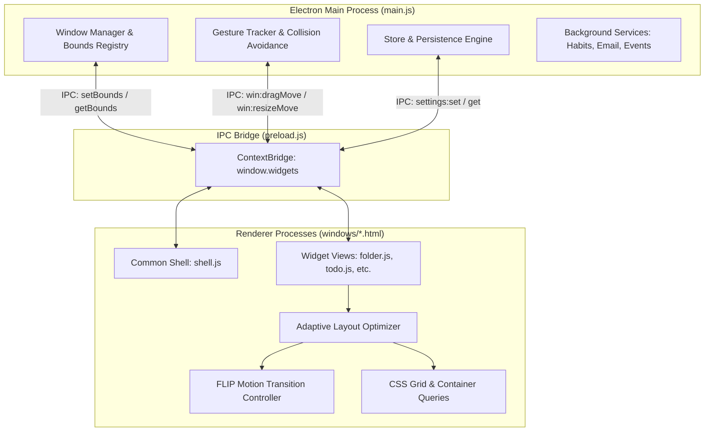
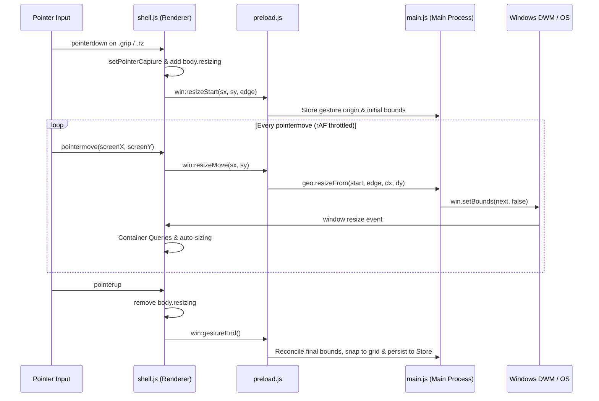

# ARCHITECTURE.md — Mirqat Widgets System Architecture

## 1. High-Level System Overview

Mirqat Widgets is an ultra-high performance desktop widget ecosystem built on Electron and modern web standards. It delivers native Windows desktop widgets with fluid resizing, multi-layered glassmorphic styling, adaptive icon grids, and instant responsiveness.

---

## 2. Architectural Subsystems

### A. Window Management & Geometry Authority
* **Primary Owner**: [main.js](file:///e:/shamela4/mirqat-widgets/main.js) (Main Process).
* **Pure Mathematical Algorithms**: [src/core/geometry.js](file:///e:/shamela4/mirqat-widgets/src/core/geometry.js).
* **Responsibilities**:
  * Tracks `BrowserWindow` instances for all widgets (`clock`, `calendar`, `todo`, `habits`, `folder`, `notes`, `email`, `pomodoro`, `quran`, `hadith`, `settings`).
  * Enforces minimum and maximum size constraints (`min: [120, 120]`, `max: [BIG, BIG]`).
  * Prevents windows from being pushed offscreen or lost outside the desktop work area.
  * Solves multi-window collision avoidance (`avoidCollisions`) and desktop grid alignment (`snapToDesktopGrid`).

### B. Hardware Gesture Tracking & Window Positioning Hot Path
* **Initiator**: [windows/js/shell.js](file:///e:/shamela4/mirqat-widgets/windows/js/shell.js) (Renderer Process).
* **Receiver**: [main.js](file:///e:/shamela4/mirqat-widgets/main.js) (Main Process).
* **Flow**:

### C. Smart Adaptive Layout Engine (Computational Geometry)
* **Pure Optimization Engine**: [src/core/adaptive-layout-engine.js](file:///e:/shamela4/mirqat-widgets/src/core/adaptive-layout-engine.js).
* **Client Bridge**: [windows/js/adaptive-layout-engine.js](file:///e:/shamela4/mirqat-widgets/windows/js/adaptive-layout-engine.js).
* **Mathematical Model**:
  * Evaluates candidate column counts $c \in [1, N]$.
  * Solves uniform cell size: $s = \min(\text{cell}_w, \text{cell}_h, s_{\max})$.
  * Evaluates multi-objective scoring function:
    $$J(L) = w_s E_{\text{size}} + w_a E_{\text{aspect}} + w_w E_{\text{waste}} + w_o E_{\text{overflow}} + w_d E_{\text{density}} + w_c E_{\text{change}} + w_p E_{\text{priority}}$$
  * Centers incomplete last rows (e.g., 7 items in 3 columns: $3 + 3 + 1$).
  * Applies hysteresis ($E_{\text{change}}$) to prevent layout flicker across breakpoints.

### D. FLIP Motion Transition System
* **Implementation**: [windows/js/flip-motion.js](file:///e:/shamela4/mirqat-widgets/windows/js/flip-motion.js).
* **Stages**:
  1. **First**: Records bounding rectangles of existing slot elements before layout update (`firstRects.set(id, rect)`).
  2. **Last**: Updates CSS Grid styles and keyed DOM structure.
  3. **Invert**: Applies inverse `translate3d(dx, dy, 0) scale(scaleX, scaleY)` without transition.
  4. **Play**: Triggers `requestAnimationFrame` applying `transition: transform 220ms cubic-bezier(0.22, 1, 0.36, 1)`.
  5. **Auto-Cancellation**: Completely skips during active mouse resizing (`body.resizing`) or when `prefers-reduced-motion` is enabled.

---

## 3. State Management & Persistence Contracts

* **Transient State** (Updated continuously during gestures, never saved to disk):
  * Active pointer coordinates (`screenX`, `screenY`).
  * Current gesture offset (`dx`, `dy`).
  * Live temporary window bounds.
* **Durable State** (Committed atomically on gesture completion):
  * Final window position and size (`bounds: { x, y, width, height }`).
  * Widget settings, theme presets, border-radius, background opacity.
  * Stored in `userData/settings.json` via [src/core/store.js](file:///e:/shamela4/mirqat-widgets/src/core/store.js).

---

## 4. Subsystem Documentation Map

* [docs/architecture/widget-lifecycle-and-windows.md](file:///e:/shamela4/mirqat-widgets/docs/architecture/widget-lifecycle-and-windows.md)
* [docs/architecture/geometry-and-layout-engine.md](file:///e:/shamela4/mirqat-widgets/docs/architecture/geometry-and-layout-engine.md)
* [docs/architecture/interaction-hot-paths-and-resizing.md](file:///e:/shamela4/mirqat-widgets/docs/architecture/interaction-hot-paths-and-resizing.md)
* [docs/architecture/state-and-persistence.md](file:///e:/shamela4/mirqat-widgets/docs/architecture/state-and-persistence.md)
* [docs/development/workflows-and-testing.md](file:///e:/shamela4/mirqat-widgets/docs/development/workflows-and-testing.md)
* [docs/development/performance-benchmarks.md](file:///e:/shamela4/mirqat-widgets/docs/development/performance-benchmarks.md)
