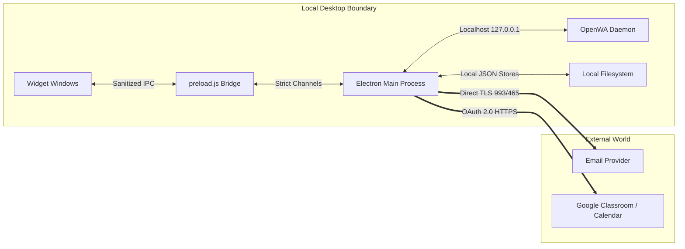

# 🪐 SHĒMA (شيمَا)

> **Sovereign Desktop Environment & Ambient Intelligent Widgets Hub**  
> *A lightweight, privacy-first, locally sovereign desktop productivity ecosystem featuring seamless glassmorphic widgets, deep classroom integration, ambient habit gamification, and zero cloud intermediaries.*

[](https://github.com/aolmaking/SHEMA)
[](https://github.com/aolmaking/SHEMA)
[-brightgreen?style=flat-square)](https://github.com/aolmaking/SHEMA)
[](https://github.com/aolmaking/SHEMA)
[](https://github.com/aolmaking/SHEMA)
[](https://github.com/aolmaking/SHEMA)

---

## 🧭 Overview & Philosophy

**SHĒMA** is a modern, high-performance desktop widget ecosystem engineered to reside gracefully on your screen. Built on Electron and vanilla web standards, it delivers a suite of specialized, aesthetic desktop tiles designed to eliminate digital distraction, reduce cognitive load, and give users complete sovereignty over their daily workflows.

### Core Architectural Pillars

1. **100% Local-First & Zero Cloud Intermediaries**: Your tasks, emails, calendar events, habits, and credentials reside entirely on your machine. All external connections (IMAP, Google APIs, WhatsApp daemon) connect directly from your client machine to official provider endpoints without intermediate tracking servers.
2. **Subpixel Crisp Typography & Waterglass Aesthetics**: Fully hardware-accelerated glassmorphic styling utilizing Windows ClearType subpixel rendering, optical caustics, and custom themes (Modern Dark, Pure OLED, Royal Emerald, Dot Grid Journal, Graph Paper, and Pencil Sketch).
3. **Battery Longevity & Minimal CPU Footprint**: Idle widgets consume less than 0.2% CPU and operate under 40 MB RAM. All background polling engines (Classroom sync, email checking, urgent alerts) use unreferenced timers (`.unref()`) to prevent unwanted processor wakeups on laptops.
4. **Non-Intrusive White-Hat Gamification**: Replaces punishing, shame-inducing gamification models with genuine behavioral psychology, progressive landmark restoration, cumulative trials, and guilt-free micro-step allowances.

---

## 🪟 The Widget Suite (What Each Widget Delivers)

SHĒMA is composed of dedicated, modular desktop tiles that can be positioned anywhere, snapped to grid layouts, or grouped together into intelligent folders.

```
┌────────────────────────────────────────────────────────────────────────┐
│                              SHĒMA HUB                                 │
├──────────────┬──────────────┬──────────────┬──────────────┬────────────┤
│   Habits &   │    To-Do     │    Focus     │    Dual      │   World    │
│ Living Atlas │  Classroom   │   Pomodoro   │   Calendar   │   Clock    │
├──────────────┼──────────────┼──────────────┼──────────────┼────────────┤
│    Evolved   │    Photo     │  Scratchpad  │   Noor Al-   │   Smart    │
│  Email Client│    Frame     │    Notes     │   Wahyayn    │  Folders   │
└──────────────┴──────────────┴──────────────┴──────────────┴────────────┘
```

---

### 1. 🗺️ Habits & Wellness + The Living Atlas
*Your sovereign daily routine tracker and behavioral RPG world.*

- **Bullet Journal Habit Tracking**: Flexible inputs supporting Boolean checkboxes, Target Numbers, Percentages, Stopwatch Duration tracking, and 5-Star Ratings.
- **Composite Daily Wellness Index (DWI)**: A proprietary composite health metric calculating day-level wellness by cross-analyzing habit completion rates, sleep hours/quality, mood fluctuations, and screen stress.
- **Guilt-Free Continuity ("Don't Break The Chain")**: Approved leave/exemption tagging (`skip`) protects consistency streaks during illness, travel, or scheduled rest days.
- **The Living Atlas (أطلس العوالم الحيّة)**:
  - **Living Map**: 6 restore-worthy landmark regions (*The Crossroads, Sunken Library, Granite Pass, Solitary Peak, Quiet Waters, World Tree*) brought back to life as habits are completed.
  - **Miro Companion**: An ambient, glowing starlight spirit reacting to user progress with intelligent, multi-modal consultation and encouraging guidance.
  - **Celestial Astrolabe**: 5 behavioral skill branches (*Awareness, Consistency, Resilience, Reflection, Mastery*) advancing through organic habit stacking.
  - **Cumulative Major Trials**: Replaces traditional boss fights with collective endurance milestones (no countdown stress or HP wipeouts).
  - **Haven Gold Bazaar & Crafting**: Earn Haven Gold and living materials (*Seeds of Light, Manuscript Scraps, Aether Shards*) to craft restoration projects and redeem customizable real-world rewards.
  - **1-Click Micro-Step (2-Minute Rule)**: Directly execute a fallback micro-step from the desktop widget on high-resistance days to keep momentum alive without burnout.

---

### 2. 📋 To-Do & Tasks (Google Classroom Powered)
*A deadline-focused task management system with deep academic integration.*

- **Priority Hierarchy**: Clean categorization into Normal, Important, and Super-Urgent (Crisis) levels.
- **Deep Google Classroom Sync**:
  - Automated 30-minute background sync polling official Classroom APIs.
  - Real-time propagation of teacher assignment edits, cancellations, and due-date postponements.
  - Anti-accidental turn-in guard: Coursework tasks cannot be marked complete locally until officially submitted via Google Classroom.
- **Super-Urgent Monitor**: Immediate escalation, distinctive audible cues, and persistent alert banners when critical deadlines loom within 24 hours.
- **Task Ergonomics**: Inline subtask checklists, drag-and-drop reordering, and automated migration of completed tasks to bottom.

---

### 3. 🍅 Focus Pomodoro
*A focused, non-distracting work session companion.*

- **Radial Progress Timer**: Configurable work/break intervals (default 25 min focus / 5 min short break / 15 min long break) with smooth SVG progress rings.
- **Cross-Widget Integration**: Launch a dedicated Pomodoro session directly from any habit or coursework task with a single click.
- **Ultra-Translucency & Compact Pill Modes**: Scales down to an unobtrusive floating glass pill during active work intervals to maximize screen visibility.

---

### 4. 📅 Dual Calendar & Agenda
*Astronomically precise synchronization between Hijri and Gregorian systems.*

- **Unified Astronomical Grid**: Dual-calendar display showing both Hijri lunar dates and standard Gregorian days with accurate month phase tracking.
- **Agenda & Event Scheduler**: Full modal event creation, color categorization, recurrence schedules, and drag-and-drop agenda rescheduling.
- **Subscription Feed Support**: Real-time integration via secret iCal URLs and Google Calendar export feeds without requiring developer credentials.
- **WhatsApp Agenda Briefings**: Dispatches automated or on-demand daily schedule summaries via the local WhatsApp daemon.

---

### 5. ⏰ World Clock & Time
*Precision desktop chronometer with cultural time awareness.*

- **Dual Display Modes**: Seamlessly toggle between a crisp digital readout and a smooth, continuous quartz sweep-hand analog watchface.
- **Dual Timezone Tracking**: Monitor local time alongside global counterpart zones with zero clock drift.
- **Prayer Times Countdown**: Built-in astronomical calculation engine providing gentle, timely countdowns to upcoming prayer milestones.
- **Aesthetic Watchfaces**: Choose between Minimalist, Classic Chronometer, Modern Glass, and OLED Pure Black styles.

---

### 6. ✉️ Evolved Email Client
*A lightweight, native desktop IMAP/SMTP mail hub.*

- **Direct Encrypted Transport**: Direct TLS/SSL connections over ports 993 (IMAP) and 465 (SMTP) connecting directly to your provider (Gmail, Outlook, Yahoo, Fastmail, or self-hosted).
- **IMAP IDLE Real-Time Push**: Instantaneous incoming mail notifications without battery-draining continuous polling cycles.
- **Bandwidth-Saving Header Peeking**: Reads mail headers first (`BODY.PEEK[HEADER.FIELDS]`) to conserve bandwidth and prevent server spam classification.
- **Rich Desktop Reading & Composition**: HTML message rendering, secure attachment downloader (PDF, documents, images), and swift compose/reply capabilities directly from the desktop tile.

---

### 7. 🖼️ Interactive Photo Frame
*Bring warmth and visual inspiration to your digital workspace.*

- **Single Photo & Album Modes**: Showcase individual high-resolution photos or set up rotating multi-image albums with customizable transition timing.
- **Geometric Sculpting**: Frame images in Circle, Archway, Rounded Squircle, or Minimalist Rectangle silhouettes.
- **Optical Tuning**: Direct in-widget adjustments for pan position, zoom factor, brightness, and contrast.

---

### 8. 📝 Scratchpad Notes
*Zero-friction note capture for active workflows.*

- **Always-Accessible Capture**: Instant markdown scratchpad for jotting down temporary thoughts, meeting takeaways, or code snippets.
- **Debounced Auto-Persistence**: Automatically saves content to local disk with debounced I/O to eliminate latency and prevent disk wear.

---

### 9. 📖 Noor Al-Wahyayn (Quran & Hadith)
*A spiritual sanctuary featuring authentic Islamic scholarship.*

- **Curated Daily Verses & Hadith**: Daily selections paired with authentic scholarly Tafsir (*Ibn Kathir, Al-Sa'di, Al-Muyassar*) and Hadith explanations.
- **Authentic Calligraphy & Audio**: High-contrast Arabic typography with customizable font weight, audio recitation playback, and bookmarking.

---

### 10. 📁 Smart Desktop Folders & Tile Management
*Revolutionary desktop real estate management.*

- **Folder Grouping**: Drag multiple widget tiles onto each other to bundle them into an organized Smart Folder.
- **Adaptive Layout Engine (ALE)**: Dynamically reflows widget icons with Snug-Fit grid alignment and hardware-accelerated FLIP animations.
- **Instant Dissolution**: Drag tiles out or dissolve folders with zero screen stutter or window position shifts.

---

### 11. ⚙️ Settings & Customization Hub
*Granular control over every aspect of your desktop environment.*

- **Scope-Based Theming**: Apply styles globally or isolate font choices, glass opacity, and border radii per individual widget.
- **Setup Guidance Modals `(!)`**: Step-by-step interactive walkthroughs explaining Google Cloud OAuth configuration, App Passwords, and local WhatsApp QR pairing.
- **Autostart System**: Native cross-platform system startup integration (Windows Registry / macOS LaunchAgents / Linux XDG Autostart).

---

## 🔒 Security & Privacy Architecture

SHĒMA is engineered around strict defense-in-depth principles:



| Security Layer | Implementation |
| :--- | :--- |
| **Electron Sandbox** | `contextIsolation: true`, `nodeIntegration: false`, strict `Content-Security-Policy`. |
| **Direct Client-to-Server** | Zero proxy servers or telemetry collectors; all credentials remain strictly in local storage. |
| **WhatsApp Daemon** | Bound exclusively to `127.0.0.1:2785`; strictly unreachable by external network interfaces. |
| **Authentication Safety** | Supports Google OAuth 2.0 and Application-Specific Passwords for mail protocols. |
| **Zero-Resource Shutdown** | Clean lifecycle handling: terminating the app terminates all background pollers and daemon child processes. |

---

## 🛠️ Getting Started & Installation

### Prerequisites

- **Node.js**: v18.0.0 or higher
- **Operating System**: Windows 10/11, Ubuntu 20.04+ (or equivalent Linux distribution), or macOS 12+

### Quick Start

```bash
# 1. Clone the repository
git clone https://github.com/aolmaking/SHEMA.git
cd SHEMA

# 2. Install dependencies (if applicable)
npm install

# 3. Launch the application in development mode
npm start
```

### Running the Comprehensive Test Suite

SHĒMA ships with a comprehensive suite of 56 automated test suites covering security invariants, geometry collision algorithms, IPC contracts, and gamification mechanics:

```bash
# Run all 56 verification test suites
npm test
```

---

## 📂 Project Structure

```
SHEMA/
├── assets/                 # Brand assets, storybook artwork, icons, sound chimes
│   └── brand/living-atlas/ # 13 canonical The Living Atlas illustrations
├── src/
│   └── core/
│       ├── atlas/          # Living Atlas gamification, map, skills, trials, store
│       ├── adaptive-layout # Tile geometry and grid optimization
│       ├── autostart.js    # Native OS startup management
│       ├── classroom.js    # Google Classroom API integration & poller
│       ├── email.js        # Native IMAP/SMTP transport engine
│       ├── geometry.js     # Window gesture, collision, and boundary math
│       ├── habits.js       # Core habits tracker, DWI engine, streak calculations
│       ├── openwa-server.js# Local WhatsApp bridge daemon
│       ├── paths.js        # Sovereign cross-platform data paths
│       ├── reliable-dispatch.js # Outbox queue and retry dispatcher
│       └── store.js        # Atomic local JSON persistence
├── windows/                # Modular widget view layers (HTML/CSS/JS)
│   ├── calendar.html       # Dual Calendar & Event Agenda
│   ├── clock.html          # World Clock & Prayer Times
│   ├── email.html          # Evolved Email Client
│   ├── folder.html         # Smart Desktop Tile Folders
│   ├── habits.html         # Desktop Habits Tile with Mini Atlas & Miro
│   ├── habits-dashboard.html# Full Analytics, Bujo & Living Atlas Dashboard
│   ├── notes.html          # Scratchpad Notes
│   ├── photo.html          # Interactive Photo Frame
│   ├── pomodoro.html       # Focus Pomodoro Timer
│   ├── quran.html          # Noor Al-Wahyayn Spiritual Widget
│   ├── settings.html       # Central Preferences Hub
│   └── todo.html           # To-Do & Coursework Tasks
├── scripts/                # Verification, forensic, and installation scripts
├── test/                   # Comprehensive unit and integration test suites
├── main.js                 # Electron main lifecycle & IPC coordinator
├── preload.js              # Secure contextBridge sandbox API
├── package.json            # Application manifest & npm scripts
└── README.md               # Definitive documentation
```

---

## 📜 Authorship & License

Developed with precision and sovereign care by **[aolmaking](https://github.com/aolmaking)**.  
*All rights reserved.*
